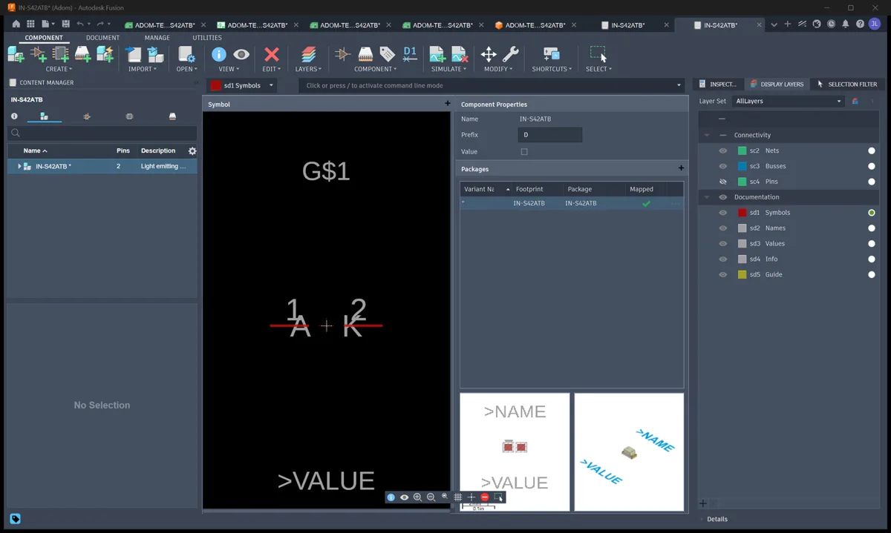
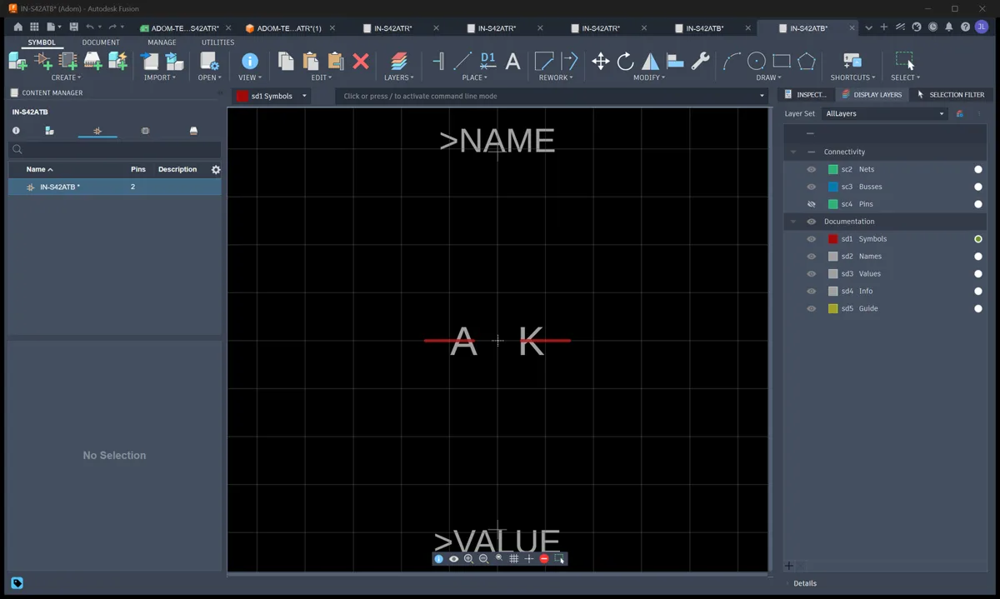
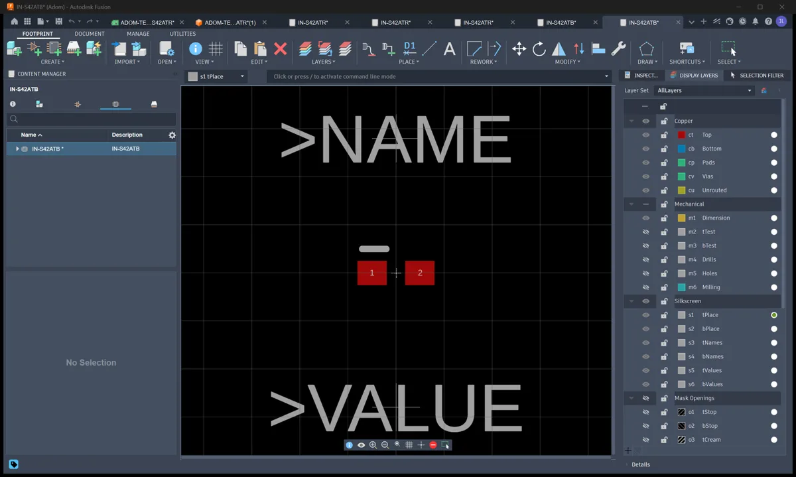
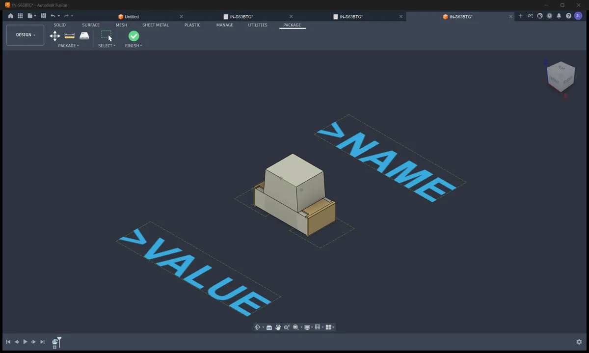
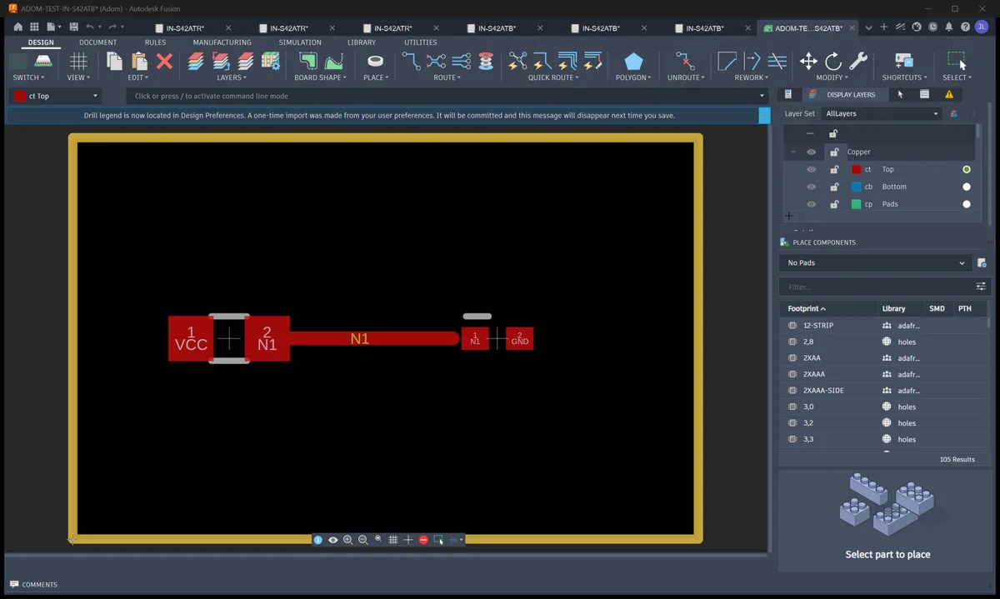
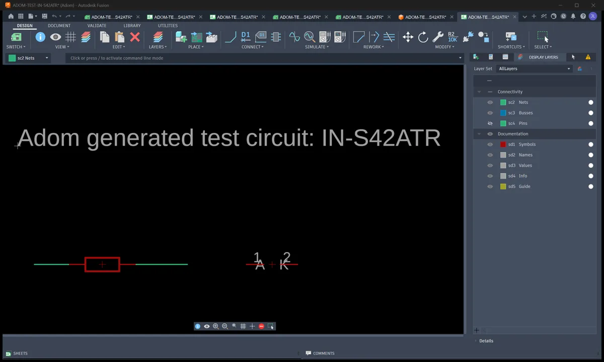
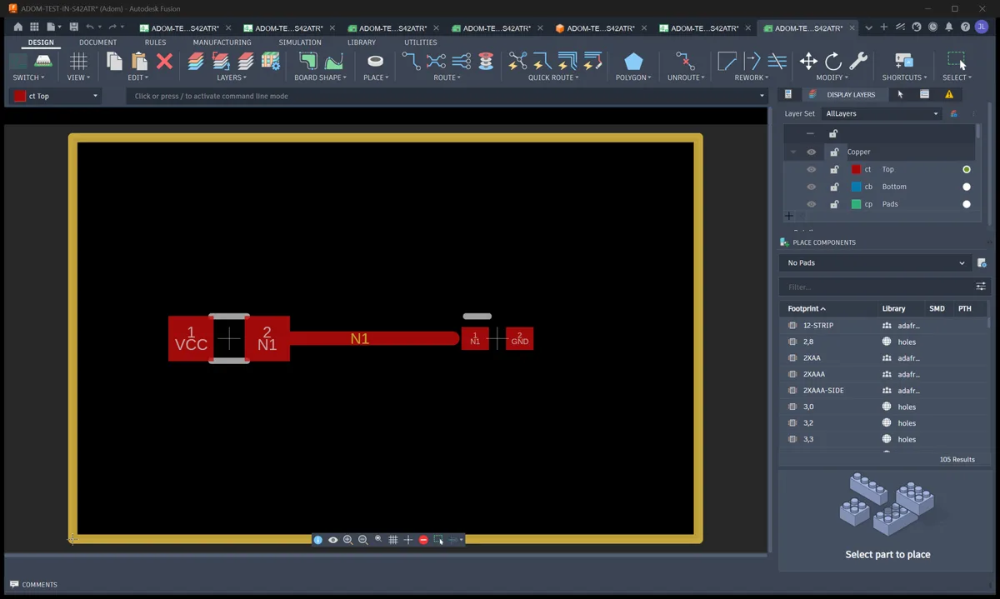
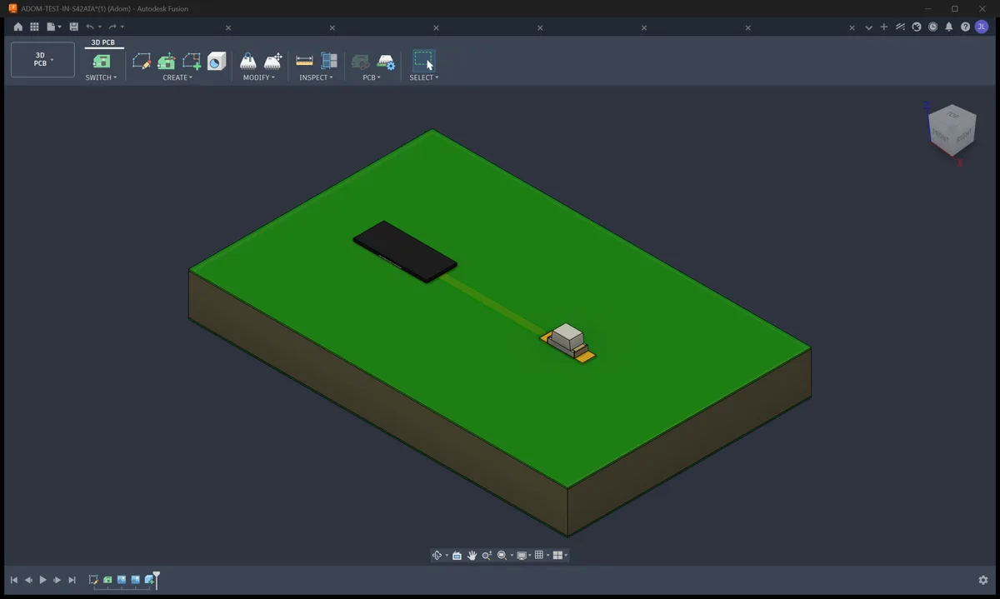

# Adom Bridge - Fusion 360 Bridge

> **This package installs the bridge's SKILLS into your container so your AI knows how to drive it; Adom Bridge loads the bridge runtime itself from the release zip.**

Drive **Autodesk Fusion 360** from the cloud through [Adom Bridge](https://wiki.adom.inc/adom/adom-bridge):
component libraries with real 3D, parametric IPC package generation with laser-etched markings,
electronics board workflows, manufacturing exports (Gerbers/BOM/CPL), per-manufacturer design rules,
and fast APS cloud-file search - all by asking your AI. Every verb returns a rich `_hint`, so a
calling AI never has to guess.

```
"generate an IPC SOIC-8 with LM358 etched on top and export the STEP"   - just ask Claude
```

## Demo video: a wiki Cloud Library becomes a proven Fusion library (1:51)

<video controls preload="metadata" width="100%" poster="demo/lan7800-cloud-library-demo-hero.png" src="demo/lan7800-cloud-library-demo.webm"></video>

[Watch the video](demo/lan7800-cloud-library-demo.webm) (webm, 1920x1200) | [Hero frame](demo/lan7800-cloud-library-demo-hero.png) | [Reproducible demo script](demo/lan7800-cloud-library-demo-script.md)

What it shows, recorded live on a real Windows desktop with the bridge driving everything: the LAN7800
component page, one click to add it to a Cloud Library, four more parts in four clicks, the library
with all five, the Fusion export with BOTH human approvals on camera (Chrome's "access other apps on
this device" prompt and Adom Bridge's own "Allow 1 hr" web-control approval), Fusion binding each
part's STEP onto its footprint with pin 1 verified, the proof pass with the in-Fusion palette
narrating, and the finished library: every part with its symbol, footprint, rendered 3D and a green
Mapped check. Narrated by TTS; every scene is its own clip in the manifest so any one can be re-shot.

## Demo videos: Hydrogen driving Fusion

Each one is a single prompt typed into Hydrogen, then Hydrogen drives Fusion through this bridge
with nobody touching the mouse. Full prompts and how they were made: [Demo videos](docs/demo-videos.md).

| | |
|---|---|
| [](https://youtu.be/KPbHgk800wE) | **Clearing a modal dialog that blocks a script** (51 s). A script runs ADD, Fusion's library picker blocks it, and the bridge reads the dialog and cancels it in the background. |
| [](https://youtu.be/Th_HwxCgleE) | **One prompt: parts library to schematic, 2D board and 3D board** (55 s). Schematic, 2D board and the 3D board with each part's real 3D model, no dialogs. |
| [](https://youtu.be/poAy__9Iggw) | **A real 3D model on every part of a library** (1:45). Why binding STEP models to a multi-part library is hard, the order that works, and six parts bound live. |

## Feature guides

Short version below, full detail in each guide.

| guide | what it covers |
|---|---|
| [APS cloud search](docs/aps-cloud-search.md) | Find any team design in ~2s instead of a 30-minute folder walk. Setup, the never-charge guarantee, why the old search is hard-blocked, and the zero-result fallback that lists sibling folders through the Data API. |
| [Schematics](docs/schematics.md) | The front door `fusion_schematic {action: open, create, show}`, a library's parts on a new schematic and board with `fusion_make_showcase_project`, driving the schematic editor, and the async EAGLE import so parts instantiate. |
| [2D board layout](docs/board-layout-2d.md) | PCB editor, design rules by fab with `ruleWarnings`, layer + stackup discovery, live per-net routing with native DRC, and gerbers/BOM/CPL for the fab. |
| [3D view, export and STEP colorization](docs/3d-viewer-and-export.md) | The 3D PCB, the native viewport frame in `fusion_state`, camera motion with `fusion_view`, every export format, web-grade GLB (16 MB to ~465 KB), and recoloring a grey imported STEP. |
| [Electronics library manager](docs/electronics-libraries.md) | Symbols, IPC footprints and real 3D packages, generated rather than hand-drawn, explicit 3D `placement`, plus how to verify a part before shipping it. |
| [Multi-part library import](docs/MULTIPART_LIBRARY_IMPORT.md) | How a zip of `.lbr` + STEPs becomes a Library Manager library with rendering 3D on every part: cloud `.f3d` urns, per-part minting (and the wrong-footprint trap it avoids), proof, and what the user sees. With screenshots. |
| [Mechanical BOM and physical properties](docs/mechanical-bom.md) | Kit-aware assembly BOM that matches Fusion's Manage to BOM, and per-part volume/mass for costing. |
| [Sign-in, sessions and updates](docs/sign-in-and-updates.md) | Multi-profile Autodesk sign-in, SSO without passwords, one login covering APS, the `needs_signin` short-circuit, `restartPolicy`, and silent auto-updates. |
| [Autodesk's Fusion MCP server](docs/fusion-mcp-server.md) | Proxy Autodesk + Anthropic's local MCP server (text-to-CAD, Electronics object model) so a cloud AI can reach it, and turn it on for the user. |
| [Demo videos](docs/demo-videos.md) | Three short demos of Hydrogen driving Fusion (dialogs, library to 3D board, 3D library binding): the exact prompts, how they were recorded and cut, and where we share them. |
| [Driving Fusion's preferences](docs/fusion-preferences.md) | Reach ANY Fusion preference, not just the thin API slice, by driving the Preferences dialog. |
| [Contributing](CONTRIBUTING.md) | Check out the source, change it, test it on your own box, and send a pull request for review. Account and CLI setup, the dialog rules, unsigned local builds, the verb suite, and how review and approval work. |


## New in 1.12: the board model, stack-up, netlist, schematic file read and 3D heights

The Fusion bridge now speaks the [EDA Bridge Standard](https://wiki.adom.inc/adom/eda-bridge-standard):
the same board model and the same verb names as the Altium and KiCad bridges, so one AI can read and
check a Fusion board exactly the way it reads an Altium or KiCad one. Every read below runs in the
background from Fusion's own data: no window, no mouse, no dialog.

| what you ask | verb | what you get |
|---|---|---|
| "read the board", "what is on this PCB", "list every pad and its net" | `fusion_routing_state` | The whole board in millimetres, Fusion's frame: tracks, arcs (center, radius, angles), vias, every pad with size, shape, rotation, layer and net, parts with side and footprint, pours, net-less copper, the outline as edges with its arcs, and the copper layers named `F.Cu`, `In1.Cu`, `B.Cu` as on every other EDA tool. A custom-shape pad (a power FET's drain drawn as a footprint polygon) is its bounding rectangle, never 0 x 0. |
| "is everything connected", "which nets are still open" | `fusion_routing_state` | `unconnected` and `splitNets` are computed from the copper itself (pads, tracks, vias and Fusion's poured fill joined where they touch), so the count is right even before Fusion recomputes its ratsnest. Fusion's own airwire count rides along as `fusionAirwires`, and the hint explains any difference. |
| "what is the stack-up", "copper thickness", "dielectric constant", "board thickness" | `fusion_layer_stack` | Copper layers top to bottom with copper micrometres, the dielectric below each (thickness, Dk, prepreg or core) and the total, from Fusion's Layer Stack Manager. What impedance and current-capacity checks read. |
| "what is poured", "copper pour area", "which pours never filled" | `fusion_pour_state` | Each pour as drawn and the copper Fusion actually poured, island by island with its holes (`zones`), plus filled area per layer and per net. |
| "netlist", "check the nets against my circuit" | `fusion_netlist` | Every net with its pads as `U1.3`, from the live board or straight from a `.sch` file with Fusion closed. `expect` compares it pin by pin and lists what is missing or extra. |
| "read the schematic file", "pin types", "which pins are power" | `fusion_read_sheet_file` | Every part of an EAGLE `.sch` (or the one inside a Fusion `.fsch`) with its value, part number, library, sheet and position, and every pin with its pad and electrical type (input, output, power, passive...). Milliseconds, no Fusion needed. |
| "how tall is it", "will it fit the enclosure", "which parts have no 3D model" | `fusion_bodies` | Each part's 3D body as a box: footprint rectangle and height above the board, how far through-hole leads stand out of the far side, the parts with no 3D model, and the ones whose model is not where the board puts the part (off its footprint, floating or sunk). |
| "list the parts", "where is U3", "what nets does Q1 touch", "pins of U1" | `fusion_component_data`, `fusion_component_pins`, `fusion_list_designators` | Each part's footprint, value, side, position, rotation, extent, pads, nets and part number; each pin's net, position, size and drill. |
| "list the nets", "how long would this net be", "which pads are on GND" | `fusion_list_nets`, `fusion_net_connections`, `fusion_net_classes` | Every net with its pad, track, via and pour counts and class; every pad by net with each net's span and airline length; the net classes with width, drill and clearances. |
| "which layers are used", "show the copper layers" | `fusion_layers`, `fusion_copper_layers`, `fusion_layers_in_use` | The layer set with kind and visibility, the copper stack in order, and how many primitives each layer carries. |
| "what are the design rules", "clearance rules", "minimum trace width" | `fusion_read_rules`, `fusion_rules_by_kind` | Every rule in Fusion's rule manager (kind, scope, value, priority, enabled) and the classic rule values. |
| "where are the designators", "silkscreen" | `fusion_silk_state` | Each part's body box and its designator and value text as placed, plus the board's free silkscreen. |
| "run DRC", "check the board for errors" | `fusion_run_drc` | Fusion's own DRC: every violation with its rule, error or warning, layer and position, and counts by rule. |
| "refill the pours", "zoom to U1", "show me the GND net" | `fusion_repour`, `fusion_zoom_to` | Refill every pour and read the copper back; frame the view on a rectangle, parts or a net. |
| the standard's names | `fusion_launch`, `fusion_board_summary`, `fusion_export_gerber`, `fusion_dismiss_dialogs`, `fusion_install` | The EDA Bridge Standard's names for verbs this bridge already has; the reply says `aliasOf`. |

Net names with `!` (active-low signals such as `!CE`, `!INT`) are accepted by every routing verb.

## New since 1.10

Short entries, newest behavior first in each guide. The [changelog](CHANGELOG.md) has every release.

| what | verbs and fields | in short |
|---|---|---|
| Schematic front door | `fusion_schematic {action: open, create, show}` | One verb for every way into a schematic. `open` takes a cloud `fileName`, `urn` or `query`, a local EAGLE `schPath`, or a Fusion-native `filePath`. `create` writes a blank EAGLE schematic on the box and opens it with no dialog. `show` switches the open design to its schematic view. Every reply names the verb that did the work in `via`. |
| Showcase project | `fusion_make_showcase_project`, `fusion_eagle_import_status` | Puts every deviceset of a library (or the ones in `devicesets`) on a new schematic and a new board, with no nets and with the library's bound 3D carried across. It is generated as EAGLE source and opened dialog-free. It is async: it returns a `runId`, and you poll `fusion_eagle_import_status`. |
| Live per-net routing | `fusion_routing_state`, `fusion_plan_route`, `fusion_route_net`, `fusion_routing_drc` | Read the live board, plan a bounded two-pad path, create copper trace by trace with board and revision guards, then run native Autodesk DRC. Each DRC error carries `layer`, `x` and `y` in mm. |
| Design rules by fab | `fusion_set_design_rules` | `{action:"list"}` lists every fab, process and layer count from the rule packs on [adom/pcb-design-rules](https://wiki.adom.inc/adom/pcb-design-rules). Applying a profile returns `ruleWarnings` when the profile carries a rule that native DRC will report as noise. |
| Explicit 3D placement | `fusion_make_3d_package`, `fusion_build_library_3d` | `placement: {translation, rotation, scale:1}` applies the manufacturer's authored transform and bypasses every heuristic. `orient:false` imports the model exactly as authored. |
| Native viewport frame | `fusion_state` | The reply carries `nativeViewport`, `geometry` and `windowPixels`, so a blank window capture is reported as blank and the frame Fusion itself renders is there to use. |
| APS zero-result fallback | `fusion_aps_search` | A zero from the server index never stands alone. The reply carries `data.fallback` and `data.completeness`, and sibling folders are listed through the Data API. |
| Caller-aware prove | `fusion_create_library`, `fusion_install_library_bundle`, `fusion_prove_result` | An AI thread binds and places only (`verdict: bound_not_proven`). Web control proves. `prove:true` or `prove:false` always wins. |
| Restart policy | `restartPolicy`, `allowRestart`, `fusion_restart_for_addin` | Under the default `auto` the bridge restarts Fusion itself when the add-in needs it, never for a busy add-in and never over unsaved work it could not save. Chains never restart Fusion unless the caller passes `allowRestart:true`. |
| Sign-in short-circuit | `needs_signin` | Every add-in verb answers `errorCode: needs_signin` in under a second while Fusion is signing in. |

### The schematic front door: `fusion_schematic`

A schematic is a view of an electronics design, not a file of its own, so there is one verb that
gets you there from whatever you have. `fusion_schematic {action:"open"}` lands in the schematic
editor from a cloud `fileName`, `urn` or `query`, from a local EAGLE `.sch` (its sibling `.brd` is
imported with it so parts instantiate, or pass `withBoard:false` for a dialog-free schematic alone),
or from a Fusion-native `.fsch`. `{action:"create"}` writes a blank EAGLE schematic on the box and
opens it as a new local electronics design with no dialog. `{action:"show"}` switches the design
that is already open. When a name search opens the 3D PCB or a mechanical file instead, the verb
retries the exact cloud name once and otherwise answers `not_an_electronics_design` with the
candidate documents.

```bash
adom-bridge fusion_schematic '{"action":"open","query":"BQ25792"}'
adom-bridge fusion_schematic '{"action":"create","name":"scratch"}'
```

### Show off a library: `fusion_make_showcase_project`

"Make a schematic and board with these three sensors on it" is one call:
`fusion_make_showcase_project {libraryPath, devicesets?, name?}`. Every deviceset in the library (or
the ones you name) is placed in a row on a fresh sheet and a fresh board, with no nets, and the
library's bound 3D urns are carried across so the 3D PCB shows the real bodies. The two documents
are named `<name>-sch` and `<name>-brd`, the board opens last so it is active for the 2D and 3D
views, and each view is fitted. The verb is async: it returns a `runId` and you poll
`fusion_eagle_import_status {runId}`. The library block is embedded verbatim, because Fusion
refuses a schematic whose library was re-assembled piecewise from a Fusion-exported `.lbr`.

### Live per-net routing

Four verbs route a live two-layer board one net at a time. `fusion_routing_state` reads the board
as the EDA Bridge Standard's board model (above) with its identity and a revision that changes only
with copper, parts or outline. `fusion_plan_route` calculates a
read-only, bounded orthogonal path between two pads. `fusion_route_net` creates the copper with
board and revision guards and reads the exact copper back. `fusion_routing_drc` runs native
Autodesk DRC, and each error carries `layer`, `x` and `y` in mm, plus a `summary` by description
and a note when Overlap warnings are same-signal joints. The geometric preflight is conservative.
Native DRC is the final word. Detail in [2D board layout](docs/board-layout-2d.md).

### The dialog policy

A dialog in front of Fusion is never a reason to restart it. The bridge reads every dialog through
UIA (title, text, button names) and expires it safely without a person: the known ones through
their rule, the unknown ones with WM_CLOSE, which is Cancel or the X and never saves or discards.
When that clears it, the verb runs (`dialog_expired_retry` after a timeout). Only a dialog that
survives comes back, as `blocked_by_dialog` with `dialogs[] {hwnd, title, category, text, buttons,
resolution}`, so the AI answers it by button name. Native Windows Open and Save dialogs are read
and expired like any other, and Fusion's own tool windows do not count as dialogs.

### Restarts, prove and sign-in

- `restartPolicy` (in `~/.adom/fusion-bridge/prefs.json`, or the env var
  `ADOM_FUSION_RESTART_POLICY`) defaults to `auto`: the bridge restarts Fusion in the background
  when the add-in needs it (`addin_restarting`), saves what Fusion can save, stops short of any
  unsaved work it could not save (`restart_needs_decision`), and records the restart in the action
  ledger (`fusion_action_ledger`). `ask` keeps the confirmation toast and the wait, for a machine a
  person shares with the AI. `force` discards and kills when that is what it takes, for a machine
  only an AI drives. A busy add-in (`fusion_addin_busy`, readiness `addinBusy`) is never restarted.
- Chains (`fusion_create_library`, `fusion_install_library_bundle`) never restart Fusion on their
  own. `allowRestart:true` with `restartReason` is the only way, and the restart is recorded in
  `restarts[]` on `fusion_prove_result`. A long operation in flight answers `fusion_addin_busy`
  instead of being mistaken for a dead add-in.
- Prove is decided by the caller. An AI thread binds and places only (`verdict:
  bound_not_proven`, `partsBound`, the library path). Web control proves. `prove:true` or
  `prove:false` always wins, and the reply says what prove costs before it starts.
- While Fusion's main window says it is signing in, every add-in verb answers `errorCode:
  needs_signin` in well under a second, with `needsSignin`, `mainTitle` and a hint that points at
  the sign-in skill. It is the same signal as `fusion_readiness`, never a reason to restart.


## The demo: one verb, a whole guided tour (`fusion_demo`)

> **Tour mode** (`fusion_demo {"mode": "tour"}`): the ASYNC showcase for progress-bar
> front-ends - walks symbol, footprint, device view, 3D package off the bundled sample
> library (plus project/schematic/2D/3D via `fusion_make_test_project` by default, or a
> cloud design when `query` names one), reports `{percent, stepLabel, elapsedSec,
> estimatedSec}` via `fusion_demo_progress`, and the final poll carries the screenshot
> gallery (`shots: [{title, image}]`). Background by default. The staged onboarding flow
> below remains bare `fusion_demo {}`.

New to this? Run **one verb** and watch:

```bash
adom-bridge fusion_demo '{}'
```

`fusion_demo` takes a first-time user from nothing to a real board. It launches Fusion, **finishes
the Autodesk sign-in**, turns on cloud search, and then walks the actual story of a PCB:

**electronics project -> schematic -> 2D board layout -> 3D board**, screenshotting each view.

It is **staged and resumable**: each call advances as far as it safely can and returns `stage`,
`done`, a `narrate` line written for a newcomer, the `screenshots` to show them, and a `_hint` with
the exact next action. Keep calling it until `done:true`.

Two things it deliberately does NOT do:

- **It never leaves you parked on the sign-in page.** It drives the sign-in through your **native
  browser** (via the Adom browser extension), because that profile is usually already signed into
  Autodesk - one click instead of a password + 2FA. An anonymous automation browser would force a
  full fresh login, so the demo never uses one.
- **It never just name-drops cloud search.** It sets **APS** up for you, then runs a live sample
  search so you watch your whole Autodesk hub return results in about two seconds.

If you decline the cloud-search setup, run `fusion_demo '{"stage":"skip_aps"}'` and the tour
continues without it. To demo a specific design: `fusion_demo '{"query":"BQ25792"}'`.

Playbook for the AI running it: the bundled **fusion-demo** skill.

## The wiki-to-EE circle: one verb per content type (NEW in 1.9.9-1.9.26)

The Web Control demo's contract: every electronics content type a wiki component page
implies, one first-class verb each, ALL background (your foreground is never touched):

| Content | Verb |
|---|---|
| Library | `fusion_open_lbr {"filePath": "C:/....lbr"}` |
| Symbol | `fusion_show_symbol {"name": "<deviceset>"}` (library open, or pass `libraryPath`) |
| Footprint | `fusion_show_footprint {"name": "..."}` |
| 3D chip | `fusion_show_3d_package {"name": "...", "libraryPath": "...", "stepPath": "C:/....step"}` |
| Project | `fusion_make_test_project {"libraryPath": "..."}` |
| Schematic | `fusion_show_schematic {}` |
| 2D board | `fusion_show_2d_board {}` |
| 3D board | `fusion_show_3d_board {}` |

Each verb, live-proven on real wiki component pages (the Inolux 0402/0603 LED family):

**Library** - the Content Manager with the footprint-package Mapped check and the REAL
3D model rendering in the preview (a genuine minted cloud URN bound in `packages3d`):



**Symbol** - `fusion_show_symbol` lands in the symbol editor:



**Footprint** - `fusion_show_footprint`, pads + silkscreen cathode mark:



**3D chip** - `fusion_show_3d_package` with `stepPath`: the part's STEP body imported and
auto-oriented onto its footprint in the Package3D environment:



**Project** - `fusion_make_test_project`: the generated test design, parts placed:



**Schematic** - `fusion_show_schematic` on the generated circuit (R1 in series with the
part, VCC/GND):



**2D board** - `fusion_show_2d_board`: both parts placed, net routed (gerbers export
from here):



**3D board** - `fusion_show_3d_board`: the REAL component model rendered on the board
(resolved from the element's `package3d_urn`):



**Bare-artifact wrapping**: `fusion_show_symbol` / `fusion_show_footprint` also accept a
raw `<symbol>` / `<package>` XML fragment (`symbolXml` / `packageXml`) - the bridge
generates a minimal wrapper library around it so a one-off artifact shows properly in
the Library Manager. Single-artifact libraries (symbol-only, footprint-only) are valid;
a 3D-only library parses but has nothing to display (a 3D binding needs a package).

**`fusion_make_test_project`** is the from-scratch answer for "a customer only has a
component page": it generates a minimal test circuit (the part + a generated 330R series
resistor, routed on a small board) as real EAGLE .sch/.brd server-side and imports both
DIALOG-FREE via `Document.newDesignFromLocal`. No cloud, no sign-in. After it, the
schematic/2D/3D verbs work on the result - and if the source library carries a 3D
binding, the generated board's element gets `package3d_urn`, so the 3D PCB renders the
REAL component model, not a generic extrusion.

**The correct library (3D rendering in the Content Manager)**: mint a real cloud URN
with `fusion_make_3d_package` (returns `wip_urn`; needs a signed-in session - the ONE
cloud-dependent step in the circle), bind it into the `.lbr`'s `<packages3d>`, reopen.
Autodesk's thumbnail service lags ~2-3 min behind a fresh mint. Or skip the dance:
**`fusion_bind_library_3d {"libraryPath": "...", "stepPath": "..."}`** does mint +
bind + reopen in one call (shipped 1.9.28).

**Background etiquette (hard contract)**: every verb above runs in the background - the
envelope denies Fusion's self-activation grabs, yields to real user input (it never
fights the human), keystrokes go via PostMessage, and native modal dialogs are banned
from automation. The user can keep typing in other threads the whole time. Pass
`foreground: true` on any window-raising verb when the user explicitly wants to watch.

## Component library manager - the Adom basic parts library

The bridge builds and opens full EAGLE-format component libraries in Fusion's library editor. Below:
the **entire Adom basic parts library** (138 parts - 0402/0603/0805 R/C/L, LEDs, and more) open in
the Content Manager: the component list, the R-0402 deviceset's schematic symbol, footprint + 3D
chip previews, and the footprint/package **Mapped** check EEs look for.


- `fusion_open_lbr` - open any `.lbr` in the library editor
- `fusion_build_library_3d` - build a whole RENDERING multi-part 3D library in one call
- `fusion_capture_library_views` - capture the symbol / footprint / component view per part
- Get the library: [adom-basic-parts-fusion-lbr](https://wiki.adom.inc/adom/adom-basic-parts-fusion-lbr)

<video controls width="100%" src="https://wiki.adom.inc/api/v1/pages/fusion-bridge/files/AdomBasicParts-138-library.mp4"></video>


## Generate IPC packages from parameters (ElectronicsPackageGenerator)

Fusion ships a built-in **ElectronicsPackageGenerator** add-in (~50 package families with IPC-7351B
calculators). This bridge drives it **headlessly** via `fusion_generate_package`: parametric 3D
package + laser-etched marking + STEP export, in ONE call, a few seconds per part.


```bash
adom-bridge fusion_generate_package '{
  "type": "soic",
  "params": {"DPins": 8, "D": 4.9, "E": 6.0, "E1": 3.9, "e": 1.27, "A": 1.6, "A1": 0.1, "b": 0.41, "L": 0.84},
  "etch": "LM358\nADOM-A",
  "outputStep": "C:/tmp/ADOM-LM358-SOIC8.step"
}'
```


**Why this matters:** the output is OUR generated geometry from open IPC-7351B math - **no vendor
CAD licenses, no redistribution restrictions** - the royalty-free path to a complete component
library. Families: chip (0402/0603/0805...), soic, soj, sot23/143/223, son, qfn, qfp, plcc, bga,
dfn2/3/4, dip (+sockets), dpak, melf, molded, ecap, radial + axial passives, crystals (+HC49),
oscillators, headers (straight/right-angle, socket/SMD), standoffs, chip arrays, LEDs.

**Markings that read like real silkscreen:**
- **Raised WHITE text by default** (a thin positive extrude painted white - the contrast humans can
  read; `etchStyle:"engraved"` for a sunken laser cut when a datasheet calls for it).
- The top surface is found from the **whole-chip bounding box**: only upward faces in the **top 5%
  height band** count (terminals tie the body on height), then **largest area** wins.
- Text runs along the **longest axis** of the face (auto-rotated 90° when needed), with a **10%
  margin ENFORCED by measuring** the placed text and shrink-to-fitting - never a font-metric guess.
- **Multi-line**: `"LM358\nADOM-A"` = MPN + variant, per-line auto-fit.
- A **sidecar manifest** (`<step>.manifest.json`) records every setting picked + WHY + the
  calculated bboxes, so a marking refresh (adding a variant line later) reproduces placement exactly.


The exported STEP is **colored** (AP214): the white marking arrives white in KiCad's 3D viewer.

## Electronics boards: project -> schematic -> 2D board -> 3D board

A Fusion electronics design is a parent/child chain: the **PROJECT** file (open THIS) links the
schematic, the 2D board layout, and the generated 3D PCB. The bridge opens the project and switches
views on command - each `show_*` verb returns a screenshot array so the AI SEES what it switched to.

| View | Verb |
|---|---|
| Project (parent: schematic + 2D + 3D previews) | `fusion_open_cloud_file` / `fusion_aps_open` (the project file) |
| Schematic | `fusion_schematic {action:"open"}` from anywhere, or `fusion_show_schematic` on the open design |
| 2D board layout | `fusion_show_2d_board` |
| 3D board | `fusion_show_3d_board` (orbit it with `fusion_view {action:"orbit"}`) |

Real Adom boards driven through it - the DRV8411A copper layout in the 2D editor, and the TI
DRV8323SR + ST VL53L8 boards rendered as populated 3D PCBs:


Always open the PROJECT - opening a child (.brd / 3D) directly gives an isolated view. The open
verbs reprimand via `_hint` if you open a non-project file.

## Manufacturing exports: Gerbers, BOM, CPL

One verb each, straight from the open board:

```bash
adom-bridge fusion_export_gerbers '{"outputPath": "C:/tmp/gerbers"}'   # JLCPCB-ready CAM job
adom-bridge fusion_export_bom     '{"outputPath": "C:/tmp/bom.csv"}'   # grouped by value+package
adom-bridge fusion_export_cpl     '{"outputPath": "C:/tmp/cpl.csv"}'   # pick-and-place centroids
```

Plus mechanical exports: STEP / IGES / STL / 3MF / USDZ / OBJ / DXF / DWG. Long exports return
promptly with `statusVerb: fusion_get_app_state` - the AI polls instead of blocking.

## Design rules per manufacturer

`fusion_set_design_rules` loads a fab's design rules into the open board, so DRC matches what the
fab checks. The rule packs live on the wiki page
[adom/pcb-design-rules](https://wiki.adom.inc/adom/pcb-design-rules) (JLCPCB, PCBWay, OSH Park,
Seeed, Eurocircuits, Aisler, Elecrow, Advanced Circuits, Sierra, MacroFab, NextPCB, ALLPCB and
3rd party fab), one `.edru` per vendor, process and layer count.

```bash
adom-bridge fusion_set_design_rules '{"action":"list"}'                 # every fab, process, layers row (no Fusion needed)
adom-bridge fusion_set_design_rules '{"fab":"jlcpcb","layers":"2"}'     # fetch, stage and load that profile
adom-bridge fusion_set_design_rules '{"druPath":"C:/tmp/house.edru"}'   # a local rule file as-is
```

With no `fab` the bundled 3rd party fab rules load, and `layers` auto-detects from the open board.
The reply carries `ruleWarnings` when the profile has a same-signal Copper Clearance rule over an
all/all or trace scope, which native DRC reports as Overlap warnings at every pad entry and trace
joint. Confirm the load with `fusion_alerts`: a refused file is an in-canvas toast, never a dialog.
The matching JLCPCB CAM jobs used by `fusion_export_gerbers` ship in `resources/`.

## How the bridge talks to Fusion (architecture)


The bridge picks the right channel per task:

1. **The bridge exe** (`adom-fusion-bridge.exe`, Rust, source under `rust/`): spawned by Adom Bridge, receives every `fusion_*` verb. The Python server left the package with the first exe-only release, 1.9.357 (2026-09-04); since 1.10.0 no sidecar exists at all.
2. **AdomBridge add-in** - installed BY the bridge into every Fusion add-in location
   (`%APPDATA%\Autodesk\FusionAddins` on 2025+ Fusion, plus the legacy `API\AddIns` dirs - Fusion
   moved this across versions and silently ignores the others). It serves HTTP :8774 inside Fusion
   and marshals work onto Fusion's single main thread via CustomEvent.
3. **In-Fusion channels**: the `adsk` Python API for data/geometry, `executeTextCommand` for EAGLE
   editor commands (EDIT / ADD / WINDOW FIT), `Electron.run` for electronics-UI JS
   (zoom/pan/select), and `run_modeling_script` for free-form CAD (this is how EPG packages and
   laser markings are generated).
4. **Win32 / UIA side channel** - when the API can't reach it: background hwnd screenshots, WM_CLOSE
   dialog dismissal (no focus steal), SendInput keys/clicks, and ab core verbs
   (`desktop_find_control` / `desktop_ui_click`).
5. **APS cloud** (inside the exe): fast server-indexed search + file ops at scale (below).

## Dialog awareness: parent/child screenshots (the automation breakthrough)

[](https://youtu.be/KPbHgk800wE)

*Demo: a script runs ADD, Fusion's modal picker blocks it, and the bridge reads it and cancels it in the background.*


Fusion's classic failure mode is a **modal dialog** (save prompt, recovery, licensing) silently
blocking the add-in's main thread while the caller sees only a fake "not responding". The
breakthrough: Adom Bridge's window capture returns a window's **owned child popups** - dialogs that
don't even enumerate in a normal window list - so every mutating verb returns a **classified dialog
array + screenshots** and the AI can never fly blind past one.


- Benign launch errors (an incomplete webdeploy folder) are **auto-dismissed in the background**
  (WM_CLOSE - never a focus-stealing Escape).
- DECISION dialogs - like the seat conflict above, whose options suspend Fusion on the user's OTHER
  machine - are **never auto-picked**: the bridge returns `needsUserDecision:true` and the AI
  notifies + asks the user.
- `fusion_state` carries the classified dialog list (`blockingDialogs`) on demand, and
  `fusion_dismiss_blocking_dialogs` answers the known-safe ones.
- A dialog is never a reason to restart Fusion. See "The dialog policy" above: the bridge expires
  what it safely can and returns the rest as `blocked_by_dialog` with its text and buttons.

## Fast cloud search + file management (APS) - the ONLY cloud-search path

`fusion_aps_search` finds any design in the team's Fusion cloud in **~2 seconds** (server-indexed),
plus browse / recent / file-info / versions / upload / download / folder creation, and
`fusion_aps_open` opens any design by name at any folder depth.

### Why APS (and why the old in-app search is now DISABLED)

Autodesk offers **no fast file-search API** for Fusion. The only in-app option walks the cloud
folder tree from the add-in, which takes **30+ minutes** and can **crash Fusion** (WinError 10054).
We searched far and wide; **APS (Autodesk Platform Services) Data Management is the only thing
Autodesk offers that works.** So as of **v1.6.76** the old verbs
(`fusion_search_cloud_files`, `fusion_walk_cloud_tree`) are hard-disabled in code - they return
an error that redirects to APS and can no longer reach (or crash) Fusion. There is no fallback;
APS is the path. It costs a one-time OAuth sign-in, and once set up it is fast and stays signed in.

### Authentication (one-time, then silent)

APS uses Autodesk's official OAuth (PKCE). Setup is **once per company** (an admin registers the
APS app, `fusion_aps_set_client_id`), then **each user signs in once** (`fusion_aps_signin`);
tokens refresh silently afterward. Per-org by design: each company uses its own APS app and quota.
**You are never charged** - the bridge caps all calls to Autodesk's free tier.

The bridge **checks APS state in code on every cloud call** (`_aps_guarded`) and returns a rich,
self-teaching `_hint` (is it configured? signed in? token live? the full verb list, and the exact
next step) so the AI is never stuck on an opaque auth error.

### Best sign-in: your NATIVE Chrome/Edge via ABE (adom-browser-extension)

Autodesk's email OTP / 2FA and "which profile is signed in" headaches vanish if the AI drives the
browser you're **already logged into Autodesk** with. That is what **ABE
([adom-browser-extension](https://wiki.adom.inc/adom/adom-browser-extension))** provides. If ABE
isn't installed, the AI will walk you through the one-time install, then open the Autodesk auth URL
in your real profile and capture the token - **no password typing**. Fallback:
`fusion_aps_signin {allowDefaultBrowser:true}` (OS default browser).

### APS verbs

| Verb | Does |
|---|---|
| `fusion_aps_status` | configured? signed in? token live? + never-charge meter |
| `fusion_aps_signin` | one-time OAuth sign-in (prefer ABE native browser) |
| `fusion_aps_search {query}` | server-indexed name search across the whole team hub |
| `fusion_aps_open {query}` | find + open a design in Fusion, any folder depth |
| `fusion_aps_browse` / `fusion_aps_recent` | walk hubs/projects/folders, newest-modified designs |
| `fusion_aps_file_info` / `fusion_aps_versions` | version history / who / when / size |
| `fusion_aps_download` / `fusion_aps_upload` | pull/push a cloud file (no Fusion needed) |
| `fusion_aps_create_folder` | make a subfolder (never dump loose files in a shared root) |
| `fusion_aps_set_browser` / `get_browser` / `forget_browser` | remember the native browser+profile |
| `fusion_aps_set_client_id` | set the org's PKCE client id (once per company) |
| ~~`fusion_search_cloud_files`~~ / ~~`fusion_walk_cloud_tree`~~ | DISABLED (crashed Fusion) - use `fusion_aps_search` |

**Cloud hygiene:** the bridge NEVER writes to a shared project root - uploads default to an
**Adom AI Workspace** folder with per-task subfolders, and `fusion_cleanup_cloud_files` deletes
precisely by lineage URN (never by name).

## Installing Fusion for the user (or finding theirs)

The AI does the whole setup - the user never gets handed a download link:

- **Detection first:** ab detects an existing Fusion via this bridge's `detect` paths - per-user
  (`%LOCALAPPDATA%`) AND system-wide (`%ProgramFiles%`, from `--globalinstall`) webdeploy installs.
  `fusion_readiness` / ab's `bridge_readiness` answer installed/running/ready without launching
  anything.
- **AI-driven install:** if Fusion is absent, the AI OFFERS to install it and does it on a yes - the
  fusion-onboarding skill silent-installs the **free trial / personal-use tier** (plenty for viewing
  and real work), drives the Autodesk sign-in (the user types only their own credentials/2FA), and
  deploys the add-in. A **view-only trial** install is a first-class option for users who just need
  to open and inspect designs.
- **Never a manual step:** the bridge restarts Fusion itself (`fusion_stop`/`fusion_start`),
  installs the add-in to every add-in directory Fusion has ever used, and fires an ab toast the
  moment a step needs the user (sign-in, 2FA, license acceptance).

## Full verb catalog

All verbs return a rich `_hint`. `fusion_describe '{}'` is the machine-readable source of truth; this table is generated from it.
_256 verbs._ Regenerate with `python3 tools/gen-readme-verbs.py`.

**Lifecycle and readiness**

- `fusion_addin_status` - Is the AdomBridge add-in loaded and answering inside Fusion?
- `fusion_apply_fusion_update` - Readiness EXECUTOR (Rust port, Phase 3): click Fusion's update offer IN THE BACKGROUND when auto-update is on (sticky pref; fusion_set_auto_update).
- `fusion_describe` - Self-describe every verb the bridge exposes (this list) for ab's Verbs tab + runner.
- `fusion_get_app_state` - Current app state: running, active document, workspace, isElectronics.
- `fusion_install` - The EDA Bridge Standard's name for fusion_install_fusion: the same verb, same arguments and reply (marked aliasOf).
- `fusion_install_fusion` - Install Fusion 360 FOR the user - downloads Autodesk's official Client Downloader and streams the free trial silently, with NO shell_execute and NO ab approval...
- `fusion_kill` - Force-KILL Fusion 360 (taskkill /F) - the desperate path for when fusion_stop cannot close it (stuck modal / wedged process).
- `fusion_readiness` - FAST readiness check (does NOT launch Fusion): is the Fusion host app installed + running + the bridge ready to drive?
- `fusion_set_auto_update` - Turn AUTOMATIC Fusion updating on/off for this user.
- `fusion_start` - Launch Fusion 360 (if needed) and wait for the AdomBridge add-in to be ready.
- `fusion_stop` - Gracefully STOP Fusion 360: close docs cleanly + WM_CLOSE, then wait.
- `fusion_uninstall` - CASCADE CLEANUP, called by ab's bridge_uninstall BEFORE this bridge's cache is deleted (ab 2.0.35+).
- `fusion_verb_times` - This machine MEASURED timings per verb/stage - the same store that paces every progress bar and ETA.

**Sign-in and seat**

- `fusion_aps_forget_browser` - Forget the remembered Autodesk sign-in browser (re-detect next time).
- `fusion_aps_get_browser` - Show the remembered Autodesk sign-in browser (None until set).
- `fusion_aps_set_browser` - Remember the browser+profile that authed to Autodesk so every later sign-in reuses it (power users have many browsers/profiles; the OS default is usually the...
- `fusion_aps_set_client_id` - Set the org's APS (PKCE) client id used for cloud search.
- `fusion_aps_signin` - Open the Autodesk sign-in in the REMEMBERED browser+profile (not the OS default); a background listener captures the token.
- `fusion_claim_seat` - Make THIS machine the active Fusion seat, the first-class way to move a licence between boxes while testing.
- `fusion_release_seat` - Give up the Autodesk seat from THIS machine so another box can claim it with no modal at all: closes Fusion cleanly (documents are NOT discarded; an unsaved...
- `fusion_resolve_seat_dialog` - Readiness EXECUTOR (Rust port, Phase 3): detect + resolve the Autodesk seat/licensing modal ('Active Sessions Exceeded' / 'Suspend Remote Session') in the...
- `fusion_set_seat_takeover` - Read/toggle the mid-session Autodesk seat-takeover sweep (STICKY per user, default ON).
- `fusion_signin` - SELF-DRIVING as of 1.9.32: launches Fusion if needed, clicks Sign In, opens the OAuth in the right profile, TYPES THE EMAIL and advances to the exact remaining...
- `fusion_signin_2fa` - Submit Autodesk's emailed 6-DIGIT verification code to finish a Fusion sign-in, typed IN THE BACKGROUND (UIA SetValue + Invoke - never steals the user's...
- `fusion_signin_status` - The EDA Bridge Standard's name for fusion_account: the same verb, same arguments and reply (marked aliasOf).
- `fusion_web_signin` - Sign a pup browser window into an Autodesk WEB surface (library.io, the hub portal at <hub>.autodesk360.com, Autodesk Account) via Google SSO.

**Cloud files and APS**

- `fusion_aps_browse` - Browse hubs/projects/folders without launching Fusion.
- `fusion_aps_create_folder` - Create a subfolder in a project (free; needs data:create scope).
- `fusion_aps_download` - Download a cloud file to the local machine (no Fusion needed).
- `fusion_aps_file_info` - Version history + who/when/size for a file (tip + recent versions).
- `fusion_aps_get` - Raw authenticated GET against a free APS path (dev/verify helper).
- `fusion_aps_open` - Find a cloud design by name and open it in Fusion (any folder depth).
- `fusion_aps_recent` - Most-recently-modified designs across the team hub, newest first.
- `fusion_aps_search` - Server-indexed search across the whole team hub: about 20-30 s hub-wide, a few seconds with projectId (not a 30-min folder walk).
- `fusion_aps_status` - APS state: configured, signed in, token live, never-charge meter.
- `fusion_aps_upload` - Upload a local file as a NEW cloud file (free Data Management; needs data:write scope).
- `fusion_aps_versions` - Full (uncapped) version history of a file.
- `fusion_cleanup_cloud_files` - PRECISELY delete a list of cloud files by lineage urn - SAFE cleanup of AI-created clutter.
- `fusion_create_cloud_folder` - Create a subfolder in a cloud project through the signed-in Fusion session's Data API (no APS needed).
- `fusion_delete_cloud_file` - DESTRUCTIVE: delete ONE cloud file through the signed-in Fusion session's Data API.
- `fusion_list_cloud_files` - List files/folders in a cloud project (optionally a subfolder).
- `fusion_list_cloud_projects` - List the cloud PROJECTS visible to the signed-in Fusion session (hub walk - slow on big teams; prefer fusion_aps_search for finding files).
- `fusion_open_by_urn` - Open a cloud ELECTRONICS DESIGN by URN. PCB/ELECTRONICS NAV RULE: a board is NOT a standalone file - the schematic, 2D board and 3D board are VIEWS inside ONE...
- `fusion_open_by_urn_note` - (see fusion_open_by_urn)
- `fusion_open_cloud_file` - Open a CLOUD file by name (the front door to every design flow).
- `fusion_save_to_cloud` - First save of the ACTIVE document to Autodesk cloud storage with an explicit name and destination, dialog-free.
- `fusion_search_cloud_files` - DISABLED (returns an error): the in-app add-in search took 30+ min and CRASHED Fusion (WinError 10054).
- `fusion_walk_cloud_tree` - DISABLED (returns an error): the in-app add-in walk took 30+ min and CRASHED Fusion (WinError 10054).

**Libraries and 3D packages**

- `fusion_attach_3d_package` - LOW-LEVEL primitive: attaches ONE model to ONE package.
- `fusion_bind_library_3d` - LOW-LEVEL primitive: binds ONE STEP onto one deviceset.
- `fusion_build_library_3d` - Build a RENDERING multi-part 3D library in ONE call - the whole programmatic pipeline.
- `fusion_capture_library_views` - Capture the LIBRARY-EDITOR views EEs trust: the schematic SYMBOL (full pinout), the FOOTPRINT (pads + layer stack), and the COMPONENT/device view (Content...
- `fusion_create_library` - ONE-CALL library creation for web-control (one call = one consent).
- `fusion_generate_package` - Generate an IPC-7351-compliant parametric 3D package via Fusion's BUILT-IN ElectronicsPackageGenerator (EPG) - ~50 package families...
- `fusion_install_library_bundle` - COMPOSITE, the Fusion twin of kicad_install_library_bundle (#68): ONE call takes a staged Cloud Library bundle (zip of <Lib>.lbr + <Part>.step models, or a...
- `fusion_library_manager` - Open Fusion's Library Manager and switch to one of its three tabs.
- `fusion_library_parts` - Every ORDERABLE variant in a .lbr with its part numbers - offline, no Fusion needed.
- `fusion_library_views` - The EDA Bridge Standard's library_views, served by fusion_capture_library_views: pictures of library parts (symbol, footprint, 3D body on the footprint, and...
- `fusion_make_3d_package` - Create a RENDERING component 3D package (FOOTPRINT + chip, aligned) for ONE part, fully programmatically with ZERO GUI dialogs.
- `fusion_managed_library_create` - Create a NEW managed library on library.io FROM the library in front (which must already be saved in a Fusion Hub).
- `fusion_managed_library_link` - Link the library IN FRONT to an existing managed library on library.io.
- `fusion_managed_library_pull` - Pull the newest version FROM library.io into the linked library in front.
- `fusion_managed_library_push` - Push a NEW VERSION of the library in front up to its linked managed library on library.io.
- `fusion_managed_library_unlink` - Unlink the library in front from its managed library on library.io.
- `fusion_open_lbr` - Import an EAGLE .lbr library into Fusion's Electronics LIBRARY editor (Content Manager / Electronics Library workspace), not a PCB design.
- `fusion_plan_library_import` - PRE-FLIGHT for a library import: does NO work and changes nothing.
- `fusion_preflight_lbr` - PRE-ANALYZE a .lbr: will Fusion open it?
- `fusion_prove_result` - POLL a background run started by fusion_create_library or the detached fusion_build_library_3d.
- `fusion_sch_update_from_library` - Refused with unsupported, naming the libraries the design embeds: Fusion updates parts from their libraries in its Library Manager, which asks about each part...
- `fusion_show_3d_package` - Open the 3D CHIP view (Package3DEnvironment) for a library package - and the RELIABLE way to get a 3D model into a library: pass stepPath and it is attached...
- `fusion_show_attributes` - Show a component's METADATA, as data and on screen.
- `fusion_show_footprint` - Open a FOOTPRINT (package) in Fusion's library editor.
- `fusion_show_library` - Eight-surfaces contract: the LIBRARY surface.
- `fusion_show_symbol` - Open a schematic SYMBOL in Fusion's library editor - first-class, no hand-built EDIT strings.

**Schematic, board and routing**

- `fusion_autoroute` - Fusion's autorouter on the given nets, or on every net with unconnected copper.
- `fusion_board_bom` - The bill of materials from the live board's own part attributes: one line per MPN with designators, quantity, value, package, manufacturer and the Mouser...
- `fusion_board_info` - Raw board geometry XML (copper/arcs/lines) for the open board.
- `fusion_board_outline` - Report the board edge the fab gets. Fusion's edge is its Dimension layer (20) and its Gerbers export it as the outline, so there is nothing to draw: this says...
- `fusion_board_seed` - Write the design a new board starts from, as EAGLE source on this machine: the board outline, the fab's design rules (Fusion's own rules block with your...
- `fusion_board_shape` - A rectangular board outline from its corner and size: fusion_set_outline {outline:{rect:[x0Mm,y0Mm,wMm,hMm]}}.
- `fusion_board_source` - Read the live board as EAGLE XML from a fresh export: parts, copper, vias, pours with Fusion's own computed fill, and the outline.
- `fusion_board_summary` - The EDA Bridge Standard's name for fusion_board_info: the same verb, same arguments and reply (marked aliasOf).
- `fusion_eagle_import_status` - The run record of a background fusion_new_electronics_from_eagle import: stage (started | done | failed), documentName, partsExpected (elements in the .brd)...
- `fusion_electron_pan` - Smoothly PAN + zoom the view to frame a board-coordinate box (mm; get part positions from fusion_board_info).
- `fusion_electron_run` - Run an EAGLE/Electron command in the open board (the generic extension point, e.g. RUN <ulp>).
- `fusion_electron_select` - SELECT a part (by reference designator, or x/y board mm) and surface its properties - the way clicking a part reveals the properties panel.
- `fusion_electron_zoom` - Smoothly ZOOM the schematic/2D board for a recording (the whole motion is one call).
- `fusion_electronics_query` - TYPED electronics read model: rows for one of Autodesk's 49 electronics entity classes (Element, Signal, Net, Layer, Via, Smd, Wire, Pad, Part, Instance, Pin...
- `fusion_import_electronics` - Import a Fusion-NATIVE electronics file (.fsch schematic, .fbrd board, .flbr library; NOT legacy EAGLE .sch/.brd/.lbr) from the Fusion machine as a NEW local...
- `fusion_make_showcase_project` - Put a library's parts on a NEW schematic and board to SHOW THEM OFF: every deviceset in the .lbr (or the ones in devicesets[]) placed in a row on a fresh sheet...
- `fusion_make_test_project` - Create a NEW electronics test project FROM SCRATCH around a library part - the Web Control demo's PROJECT button, and the answer to 'a customer only has a...
- `fusion_new_electronics_from_eagle` - Import a legacy EAGLE .sch (+ paired .brd) into a NEW Fusion electronics design so the parts INSTANTIATE (schematic + populated board, lands in the PCB editor).
- `fusion_open_board` - Open a LOCAL legacy EAGLE .brd in Fusion's 2D board editor (dialog-free Document.newDesignFromLocal; a background open).
- `fusion_open_electronics` - Read whether an ELECTRONICS editor (schematic, board or library) is the active workspace, so you know if Electron.* text commands and fusion_electron_run will...
- `fusion_open_schematic` - Open a LOCAL legacy EAGLE .sch in Fusion's Schematic Editor (dialog-free Document.newDesignFromLocal; a background open).
- `fusion_plan_route` - Plan a path for one net between two pads on the live board without changing it (the standard's plan_route): a bounded orthogonal two-layer A* search around the...
- `fusion_render_board_3d` - A 3D picture of the board from one side (the standard's render_board_3d): Fusion's own view of the design's 3D PCB, fitted to the board, saved as an image...
- `fusion_render_schematic` - Render a schematic sheet to a PNG without opening a window, through Fusion's own EXPORT IMAGE, and keep visual baselines: baseline set stores the render...
- `fusion_route_net` - Create explicit net copper in the live Fusion canvas.
- `fusion_routing_drc` - Run fresh native Autodesk DRC and read UL_BOARD.errors, including approved errors, warnings and airwires.
- `fusion_routing_state` - Read the live board as the EDA Bridge Standard's board model, from a fresh Fusion export in the background: millimetres in Fusion's board frame, copper layers...
- `fusion_schematic` - START HERE for a schematic. ONE verb, three actions.
- `fusion_schematic_plan` - Plan a grouped schematic from a netlist: one labelled frame per block, the block's parts in a row, every connected pin given a short stub named for its net and...
- `fusion_schematic_run` - Build a schematic live: a list of complete, non-interactive EAGLE commands run one at a time on the active schematic (ADD 'dev@lib' 'NAME' R0 (x y), VALUE, NET...
- `fusion_show_2d_board` - Switch the OPEN electronics design to its 2D PCB Editor (board layout) view.
- `fusion_show_3d_board` - Switch the OPEN electronics design to its 3D PCB view (populated board).
- `fusion_show_project` - Eight-surfaces contract: bring the PROJECT/design to its top level.
- `fusion_show_schematic` - Switch the OPEN electronics design to its SCHEMATIC view (the symmetric partner of fusion_show_2d_board / fusion_show_3d_board, via Fusion's SwitchSchDocCmd).
- `fusion_update_board_from_eagle` - Make the open design's board the board in an EAGLE .brd (or a .fbrd) on the Fusion machine, in place, so the design keeps its files and gets a new version...

**Design rules and manufacturing**

- `fusion_board_stackup` - Read a board's PHYSICAL fabrication stackup (see the pcb-stackup skill): copper layer count + copper/dielectric thicknesses from the EAGLE design rules...
- `fusion_detect_layers` - Detect 2-layer vs 4-layer board (ULP + CAM comparison).
- `fusion_export_bom` - Export a Bill of Materials CSV from the open board, in the background: Comment, Designator, Footprint, Quantity, Library (grouped by value, footprint, library...
- `fusion_export_cpl` - Export the Component Placement List (pick-and-place) CSV.
- `fusion_export_gerbers` - Run the bundled JLCPCB CAM job (auto 2/4-layer) to produce the gerber + drill ZIP.
- `fusion_set_design_rules` - Load a FAB's design rules (DRC) into the open board.

**Exports**

- `fusion_export_3mf` - Export to 3MF mesh.
- `fusion_export_board_image` - Render the OPEN board (or schematic) to a PNG via EAGLE's EXPORT IMAGE with a layer preset: all, top_copper, bottom_copper, top_silkscreen, bottom_silkscreen...
- `fusion_export_cloud_file` - Export the ACTIVE Fusion Design document to a local file on the Fusion machine in one of step, stl, f3d, iges, sat or smt (despite the name it does not fetch a...
- `fusion_export_dwg` - Export 2D DWG.
- `fusion_export_dxf` - Board layers to DXF, one file per layer (the standard's export_dxf), when layers is given: the outline (Edge.Cuts: Dimension and Milling), copper (tracks as...
- `fusion_export_eagle_source` - Export the ACTIVE electronics document as plain EAGLE XML (.sch or .brd; the outputPath extension picks the format).
- `fusion_export_f3d` - Export the active design as a Fusion archive (.f3d).
- `fusion_export_fbx` - Export to FBX mesh.
- `fusion_export_gerber` - The EDA Bridge Standard's name for fusion_export_gerbers: the same verb, same arguments and reply (marked aliasOf).
- `fusion_export_iges` - Export to IGES.
- `fusion_export_lbr` - Export the electronics LIBRARY in front as an EAGLE .scr script via Electron.run EXPORT SCRIPT: a text dump of every symbol, package and device, the round-trip...
- `fusion_export_obj` - Export to OBJ mesh.
- `fusion_export_optimized_glb` - Fusion board -> wiki-grade optimized GLB.
- `fusion_export_sat` - Export to SAT (ACIS solid).
- `fusion_export_skp` - Export to SketchUp (.skp).
- `fusion_export_source` - Export the ACTIVE electronics document in Fusion's native source format via Document.CopyToDesktop: .fbrd (board), .fsch (schematic) or .flbr (library); the...
- `fusion_export_step` - Export the active design to STEP (needs the 3D view).
- `fusion_export_stl` - Export to STL mesh.
- `fusion_export_usdz` - Export to USDZ (AR / Hydrogen 3D).
- `fusion_fetch_optimized_glb` - Finish a fusion_export_optimized_glb job: bounded-poll the optimizer by jobId and write the GLB to outputPath when complete.

**View, state and capture**

- `fusion_activate_document` - Make a named open document the ACTIVE one before driving it.
- `fusion_document_info` - The active document (the standard's document_info): its name, kind (project, schematic, board, library, model), whether it is saved and has unsaved changes...
- `fusion_interactive` - Is Fusion taking input RIGHT NOW? Reads the add-in's busy flag (a long bridge command in flight), Fusion's own hasActiveJobs, and the main thread's latency on...
- `fusion_live_feed` - A ~1 fps look INTO Fusion while the bridge drives it, kept as a BOX-SIDE ring buffer (~10 min).
- `fusion_open_document` - The EDA Bridge Standard's name for fusion_open_design: the same verb, same arguments and reply (marked aliasOf).
- `fusion_save_document` - Save the open electronics design IN PLACE as a new version (no Save As, no fork): resolves the design behind whichever tab is in front (or documentName), saves...
- `fusion_screenshot_fusion` - Background PrintWindow capture of Fusion's MAIN window (largest same-title window; works occluded/bottom-of-z-order, never raises anything) or a specific...
- `fusion_set_driving_badge` - Read/toggle the 'Adom is driving Fusion' TASKBAR OVERLAY BADGE (STICKY per user, default ON).
- `fusion_set_window_sizing` - Read/toggle auto-sizing Fusion's WINDOW after launch (STICKY, default ON).
- `fusion_state` - The RENDER-ME verb (kicad_state parity, issues #28/#30): running + window + dialog + busy state PLUS a fresh background screenshot of whatever Fusion is...
- `fusion_take_screenshot` - Screenshot the Fusion window in the BACKGROUND (no focus steal, reads through occlusion).
- `fusion_view` - FIRST-CLASS camera motion. 3D (the active Design viewport, through Fusion's own camera): fit | home | iso | top | front | right | back | left | bottom | orbit...

**Dialogs and recovery**

- `fusion_action_ledger` - Read the append-only record of what the bridge did in the BACKGROUND on this machine - dialogs it answered, Untitled scratch docs it swept, Fusion auto-starts...
- `fusion_alerts` - Fusion's OWN alert toasts, read from its log.
- `fusion_cancel_run` - STOP a library import that is in flight (fusion_install_library_bundle / fusion_create_library) - the user's escape hatch from a long run, wired to a Cancel...
- `fusion_check_dialogs` - List every Fusion dialog open now, each with its title, text and buttons read through UI Automation (no screenshot needed).
- `fusion_check_recovery` - Ask whether a cloud file has a crash-recovery document waiting, which would raise Fusion's recovery modal on open.
- `fusion_close_all_documents` - Close every open document without a save dialog; unsaved work is never lost by default (the standard's close_all_documents).
- `fusion_close_document` - Close ONE document WITHOUT the modal save dialog (save:false discards silently - the automation-safe close).
- `fusion_close_window` - Close a DIALOG window by hwnd (WM_CLOSE, like clicking X) - for dialogs without Cancel/Escape handling (e.g. Recovered Documents).
- `fusion_dialog_log` - The EDA Bridge Standard's name for fusion_action_ledger: the same verb, same arguments and reply (marked aliasOf).
- `fusion_dismiss_blocking_dialogs` - Detect + classify (and optionally dismiss) blocking Fusion dialogs.
- `fusion_dismiss_dialogs` - The EDA Bridge Standard's name for fusion_dismiss_blocking_dialogs: the same verb, same arguments and reply (marked aliasOf).
- `fusion_notify_owner` - LAST-RESORT human escalation: toast the user's MAIN computer (fans out cross-ab to every peer on the relay, so it reaches them even when this bridge runs on an...
- `fusion_reset_workspace` - Bring Fusion back to a clean slate between runs: closes named documents AND the Untitled scratch the library/bind flow leaves behind (page issue #59).
- `fusion_restart_for_addin` - ASYNC: returns immediately (started:true) and restarts Fusion in the background, SAVING the user's open documents first; poll fusion_readiness until ready with...

**Modeling and parameters**

- `fusion_assembly_bom` - Structured, kit-aware MECHANICAL bill of materials for the active Design assembly (the counterpart to the electronics-only fusion_export_bom).
- `fusion_bodies` - Each part's 3D body as a box, from the design's 3D PCB: footprint rectangle in the board frame (x0, y0, x1, y1 mm) and height range above the surface it sits...
- `fusion_get_design_info` - Design-level summary of the active design: components, bodies, sketches, units, root name.
- `fusion_get_parameters` - All user + model parameters of the active design (name, expression, value, unit).
- `fusion_import_step` - Import a STEP/.stp (or other native-importable) file into a NEW Fusion design via the native import API.
- `fusion_inspect_bodies` - GEOMETRY READ-BACK: what actually got built, in MILLIMETRES.
- `fusion_open_design` - Open a LOCAL design file (routes through the add-in import).
- `fusion_physical_properties` - Per-component physical properties (volume cm3, mass kg, density, area, center of mass) for the active design.
- `fusion_run_modeling_script` - Run an adsk.fusion modeling script in the live session (sketches/extrudes/params).
- `fusion_set_parameter` - Set one parameter's expression by name in the ACTIVE 3D Design document (user parameters first, then model parameters).

**Demo and narration**

- `fusion_demo` - FIRST-TIME-USER DEMO in one verb - the thing to run when someone new wants to SEE what this bridge does (HD's installer calls this).
- `fusion_demo_progress` - Poll a running fusion_demo tour: {percent, elapsedSec, estimatedSec, step, stepLabel, done, failed, shots, shotCount, stepShot}.
- `fusion_narrate` - Play one bundled narration clip on the box now (the guided tour's voice): dock, dashboard, or any <beat>[-a|-b] clip in resources/demo-audio.

**Other**

- `fusion_account` - WHO Fusion is signed in as on this machine, and whether this machine currently holds the Autodesk SEAT.
- `fusion_align_parts` - Line parts up on a common left, right, top, bottom or centre line, or space them evenly (the standard's align_parts), by footprint box (pads, placement and...
- `fusion_apply_pours` - Draw copper pours from a plan: POLYGON per pour (net, layer 1 or 16, outline points, isolate, rank 1..6, width, thermals, orphans), skipping any already on the...
- `fusion_apply_silkscreen` - Land a silkscreen plan on the live board: designators (names) and values (comments) moved to their own location, sized, turned or hidden; free silkscreen texts...
- `fusion_change_pours` - Change existing pours in place: the pen width (the narrowest copper the fill can reach; a pen wider than a throat leaves it empty) and the isolation.
- `fusion_component_data` - Placement data for one part or every part on the live board, in the background: footprint, value (comment), library, side and copper layer, position and...
- `fusion_component_pins` - Every pad of one part with its net, position, layer, size, shape and drill (mm), the same rows fusion_routing_state gives, for one part.
- `fusion_copper_balance` - Copper per layer and how evenly mirrored layers match (bow and twist through reflow), from the board's tracks, pads and Fusion's pour fills: the shared checks...
- `fusion_copper_layers` - The board's copper layers in stack order (F.Cu, In1.Cu.., B.Cu) with Fusion's layer id, signal or plane, whether displayed, and primitives on each.
- `fusion_current_capacity` - Per net and layer, the narrowest copper against the width a current needs (IPC-2221), and the vias a layer change needs: the shared checks engine on the live...
- `fusion_edit_parts` - Edit placed parts (the standard's edit_parts): value, designator (newRef), any field (attribute; null removes it) and the lock, each read back.
- `fusion_execute_text_command` - Run a raw Fusion TEXT COMMAND (app.executeTextCommand) - the escape hatch to Fusion internals (Electron.* electronics commands included).
- `fusion_fab_check` - The board's smallest features (track, clearance, drill, annular ring, edge clearance, silk...) compared with a fab's limits: vendor names a record in...
- `fusion_generate_body` - The EDA Bridge Standard's generate_body, served by fusion_generate_package (Fusion's own package generator): a part's 3D body from its family and datasheet...
- `fusion_get_preferences` - Read current Fusion appearance/navigation preferences (theme, activeTheme, invertScrollZoom, orbitScheme, modelingOrientation, gestureNav, cameraPivot...
- `fusion_impedance` - The track width (and pair gap) for a target impedance on each copper layer, from the board's stack-up: the shared checks engine.
- `fusion_launch` - The EDA Bridge Standard's name for fusion_start: the same verb, same arguments and reply (marked aliasOf).
- `fusion_layer_stack` - The board's stack-up in the background, from Fusion's own Layer Stack Manager data in the board: copper layers top to bottom (F.Cu, In1.Cu, ..., B.Cu) with...
- `fusion_layers` - The board's layer set: id, name (copper by the standard's names, the rest by Fusion's own: SilkscreenTop, BoardOutline...), kind (copper, silkscreen, mask...
- `fusion_layers_in_use` - Which layers actually carry something: copper layers with copper (most first) and every layer with any primitive (board, footprints on their real side...
- `fusion_license_status` - The EDA Bridge Standard's name for fusion_account: the same verb, same arguments and reply (marked aliasOf).
- `fusion_list_commands` - The EDA Bridge Standard's name for fusion_list_text_commands: the same verb, same arguments and reply (marked aliasOf).
- `fusion_list_designators` - Every part designator on the live board, in natural order (C2 before C11).
- `fusion_list_nets` - Every net on the live board with its pad, track, arc, via and pour counts and its net class.
- `fusion_list_text_commands` - List Fusion's internal TEXT COMMANDS (TextCommands.List) whose name contains filter, case-insensitive; the discovery tool for fusion_execute_text_command.
- `fusion_mcp_call` - Call any tool on Autodesk's Fusion MCP server (fusion_mcp_read, fusion_mcp_update, fusion_mcp_execute, fusion_mcp_electronics_read).
- `fusion_mcp_enable` - Turn Autodesk's Fusion MCP server ON by driving Fusion's Preferences dialog for the user.
- `fusion_mcp_resources` - List Autodesk MCP resources, or read one by uri.
- `fusion_mcp_status` - Is Autodesk's Fusion MCP server up, and what does it expose?
- `fusion_mcp_tools` - Full tool list from Autodesk's Fusion MCP server INCLUDING input schemas, so you can construct a valid fusion_mcp_call.
- `fusion_move_parts` - Place parts on the live board: one MOVE (absolute, mm) and ROTATE per part, each its own undo step, then a fresh export reads every element back.
- `fusion_net_classes` - The board's net classes with their width, drill, class-to-class clearances and member nets.
- `fusion_net_connections` - Every pad with its net as Designator.Pad and position, and per net its span and airline length (the minimum spanning tree over its pads, the shortest copper...
- `fusion_netlist` - The compiled netlist: every net with its pads as Designator.Pad (U1.3).
- `fusion_place_vias` - Add vias at exact points (stitching, thermal, escape): VIA per via with its drill and diameter, then read back.
- `fusion_pour_state` - Read every pour on the live board with Fusion's own computed fill: filled area per pour, per layer and per net, and which pours were never filled (no RATSNEST...
- `fusion_prefs_close` - Apply+OK (save:true, the default) or Cancel Fusion's Preferences dialog.
- `fusion_prefs_open` - Open Fusion's Preferences dialog and optionally jump to a section, then hand back a SCREENSHOT + shotId you can click in.
- `fusion_prewarm` - Warm the bridge ahead of the first real call, WITHOUT starting Fusion: confirms the add-in is synced into every Fusion add-in folder, readies the space-free...
- `fusion_read_rules` - Every design rule on the live board from Fusion's rule manager, disabled ones included: name, kind (Copper Clearance, Minimum Copper Width, Teardrop...)...
- `fusion_read_sheet_file` - Read a schematic straight from its file, without Fusion running: every part of an EAGLE .sch (or the .sch inside a Fusion .fsch) with its designator, library...
- `fusion_remove_graphics` - Remove board-level graphics (the standard's remove_graphics): lines, arcs, rectangles, circles, polygons, texts and dimensions, by id, or every one on a layer...
- `fusion_remove_items` - Delete tracks and vias given exactly as fusion_routing_state returned them (track start, end, layer; via position).
- `fusion_remove_parts` - Remove placed parts by designator (the standard's remove_parts).
- `fusion_remove_pours` - Delete pours (all of them, or the ones named by net, layer and outline) so a board can be poured again after a refine.
- `fusion_repour` - Refill every copper pour on the live board (Fusion's ratsnest pass, with hidden fills shown again) and read the poured copper back: filled area per layer and...
- `fusion_return_path` - Signal tracks running over a gap in the neighbouring layer's reference copper, with a pour plan that closes each gap (apply as fusion_apply_pours): the shared...
- `fusion_ripup_nets` - Take whole nets' tracks and vias back up (RIPUP per net, one undo step each) so they can be routed again, wider or another way.
- `fusion_rules_by_kind` - The ENABLED design rules grouped by kind, each group in priority order.
- `fusion_run_command` - The EDA Bridge Standard's name for fusion_execute_text_command: the same verb, same arguments and reply (marked aliasOf).
- `fusion_run_drc` - Run Fusion's own design rule check on the live board in the background and read every violation back: rule text, error or warning, layer, position in mm...
- `fusion_run_erc` - Fusion's own ERC on the open board's schematic: the design's schematic tab is brought forward for the check and the board's put back; every message is read...
- `fusion_run_script` - The EDA Bridge Standard's name for fusion_run_modeling_script: the same verb, same arguments and reply (marked aliasOf).
- `fusion_save` - The EDA Bridge Standard's name for fusion_save_document: the same verb, same arguments and reply (marked aliasOf).
- `fusion_sch_bus` - Draw a bus as a polyline, optionally named by a bus label at its first point (D[0..7], or a group such as {SDA SCL}).
- `fusion_sch_bus_entry` - Add 45-degree bus entries: the short diagonal from a member wire's end onto a bus.
- `fusion_sch_connect_pins` - Wire pins to pins by Ref.Pin (matched by pad number, then pin name): one L-shaped route per pair (first leg along the from pin, or first:h|v, through via...
- `fusion_sch_connect_to_bus` - Fan pins onto a bus: per pin, a wire from the pin to beside the bus, a 45-degree entry onto it and a member label, the net named for the member (members in pin...
- `fusion_sch_create` - Add an empty sheet after the last one (Fusion numbers a schematic's sheets; it has no sheet files).
- `fusion_sch_delete_wire` - Delete schematic wires by id, by their two ends, or every wire through a point; junctions left joining fewer than three items are removed too.
- `fusion_sch_edit_label` - Edit net labels by id, point or a whole net: move to a point or by a delta, set the rotation, or rename (a label shows its net's name, so a rename renames the...
- `fusion_sch_fix_connectivity` - Find wire ends that almost touch a pin, label or other wire end (within toleranceMm) and, with dryRun:false, move each onto it.
- `fusion_sch_hierarchy` - The design's sheet tree: the root sheets in order, and under each the module instances placed on it (Fusion's sheet symbols), each with its module's ports as...
- `fusion_sch_items` - List one schematic sheet's wiring items with ids and positions (mm, y up): wires, buses, bus entries, net labels (local, global, hierarchical), power ports...
- `fusion_sch_junction` - Add junction dots at points, or remove dots by id or point.
- `fusion_sch_move_region` - Move everything inside a box by (dx, dy) as one group: parts, wires, labels, junctions and texts; wires on the pins of a moved part follow it, and wires...
- `fusion_sch_page` - A schematic sheet's page: the frame Fusion draws it in (paper size, orientation, rectangle) and the title block fields from the design's attributes.
- `fusion_sch_pins` - Every pin of the named parts (or all) on a schematic sheet: its connection point (rotation and mirror applied), symbol pin name, the pad number(s) it maps to...
- `fusion_sch_reset_fields` - Put parts' designator and value text (or other named fields) back where the library symbol places them, through each part's turn and mirror: position, rotation...
- `fusion_sch_sheet_pins` - A sheet symbol's pins: in Fusion a sheet symbol is a module instance and its pins are the module's ports.
- `fusion_sch_split_wire` - Split a schematic wire at a point into two wires with a junction dot at the cut (Fusion's way: a junction on a wire splits it), so a branch can end on a wire...
- `fusion_sch_text` - Add free text to a schematic sheet (a note, a title): size, angle and alignment, on the Info layer.
- `fusion_sch_trace_point` - Everything electrically joined at one point of a schematic sheet: the wires, junctions, labels and pins there, and each net they belong to in full (its pins...
- `fusion_select_net` - Highlight one whole net on the live board (every pad, track, via and pour of it) and, with zoom, frame it.
- `fusion_set_layer_visibility` - Show or hide one layer of the live 2D board (DISPLAY), read back from the board's own layer flags.
- `fusion_set_outline` - Replace the board outline (Fusion's Dimension layer 20, its board edge in the CAM output) with a rectangle, rounded corners optional, or a polygon (mm).
- `fusion_set_preference` - Set Fusion appearance/navigation preferences in the LIVE session - applies immediately, NO restart.
- `fusion_set_track_width` - Change the width of the existing tracks on the given nets or net class, optionally one copper layer.
- `fusion_show_3d_chip` - The EDA Bridge Standard's name for fusion_show_3d_package: the same verb, same arguments and reply (marked aliasOf).
- `fusion_silk_state` - The silkscreen as it stands: every part's body box, its designator and value texts (position, size, rotation, side, shown; a smashed part's own text, else the...
- `fusion_status` - The EDA Bridge Standard's name for fusion_readiness: the same verb, same arguments and reply (marked aliasOf).
- `fusion_zoom_to` - Frame Fusion's board view on a rectangle, a part (or several) or a whole net, with a margin.

## Two install layers (they are NOT the same thing)

This page ships **two separate artifacts**, and it matters which one you want:

| Layer | What it is | Who installs it | Contents | Size |
|---|---|---|---|---|
| **Wiki package** (`adom-wiki pkg install adom/fusion-bridge`) | **SKILLS ONLY** for a container's AI | your cloud/ah container | `SKILL.md` + `skills/**` (the AI playbooks: APS, driving, onboarding, cloud hygiene, molecule export, PCB stackup) | tiny, text |
| **Release zip** (`adom-bridge-fusion-v<ver>.zip`, pointed at by `adom-bridge-fusion-manifest.json`) | the **bridge RUNTIME** | Adom Bridge, via `bridge_install` | `adom-fusion-bridge.exe`, `describe.py`, the `AdomBridge` Fusion add-in, `resources/` | about 6 MB |

The package teaches your AI **how** to drive Fusion; the release zip is the code Adom Bridge runs on the machine where Fusion lives. Installing the package alone gives you skills with no bridge;
`bridge_install` alone gives you a working bridge whose calling AI has no skills. Most setups want both.

The release zip is deliberately **runtime-only**: demo videos and screenshots live on this page (Files
tab), never inside the artifact streamed to every user's machine.

## Install (via Adom Bridge)

```bash
adom-bridge bridge_install '{"manifestUrl": "https://wiki.adom.inc/api/v1/pages/fusion-bridge/files/adom-bridge-fusion-manifest.json"}'
adom-wiki pkg install adom/fusion-bridge   # the skills pack for your AI
```

Auto-updates via `updateManifestUrl` (ab polls on launch + every 4h). Every release lands on the
insiders manifest first, and the public manifest moves only after the pre-production gate, so the
two tiers can serve different versions. 256 verbs -
`fusion_describe '{}'` returns the full machine-readable catalog. More demos:

<video controls width="100%" src="https://wiki.adom.inc/api/v1/pages/fusion-bridge/files/library2-3d-montage.mp4"></video>

## Source code

The full source lives on this page (Files tab): the Rust exe (`rust/`), the AdomBridge add-in
(`addin/`), the verb contract (`describe.py`, `contracts/describe.json`), skills, tests and
manufacturer resources. GitHub mirror:
`adom-inc/fusion-bridge` (the wiki is canonical). MIT licensed.

## Platforms

Windows (primary, tested end to end). macOS install paths handled in `fusion_detect.py`. Linux: not
supported (Autodesk ships no Fusion host app for Linux).

## Contributing

The wiki page is the repo. Every release pushes the whole source tree (the Rust exe, the Fusion
add-in, the verb contract, the skills, the tests) to
[adom/fusion-bridge](https://wiki.adom.inc/adom/fusion-bridge), and pull requests are reviewed
there. A GitHub mirror exists, and the wiki repo is canonical.

If your AI had to work around the bridge, that workaround is a contribution waiting to happen.
Every failing reply from the exe carries a `_contribute` field that says where to file it or fix
it, and `fusion_describe` carries a `contribute` block with the same pointer. The
`fusion-contributing` skill (installed with the package) walks an AI through the whole loop: file
the issue with the reply JSON, clone with `adom-wiki repo clone adom/fusion-bridge`, make the
change, build the exe, try it on your own box behind a dev pin, and send the pull request with
`adom-wiki pr create`. [CONTRIBUTING.md](CONTRIBUTING.md) has the same commands for people.

Bug reports with a repro (like [#55](https://wiki.adom.inc/adom/fusion-bridge/discussions/55) and
[#63](https://wiki.adom.inc/adom/fusion-bridge/discussions/63), both root-caused and fixed)
directly shape releases.
